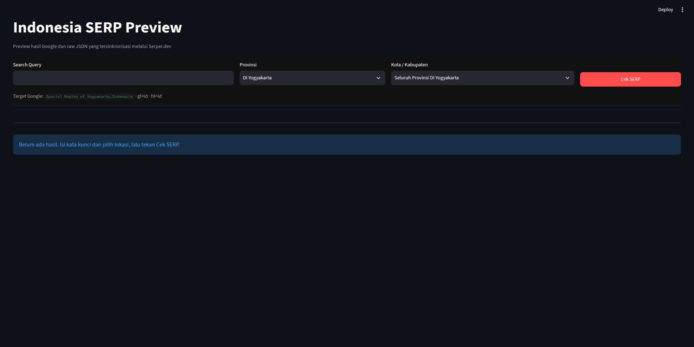
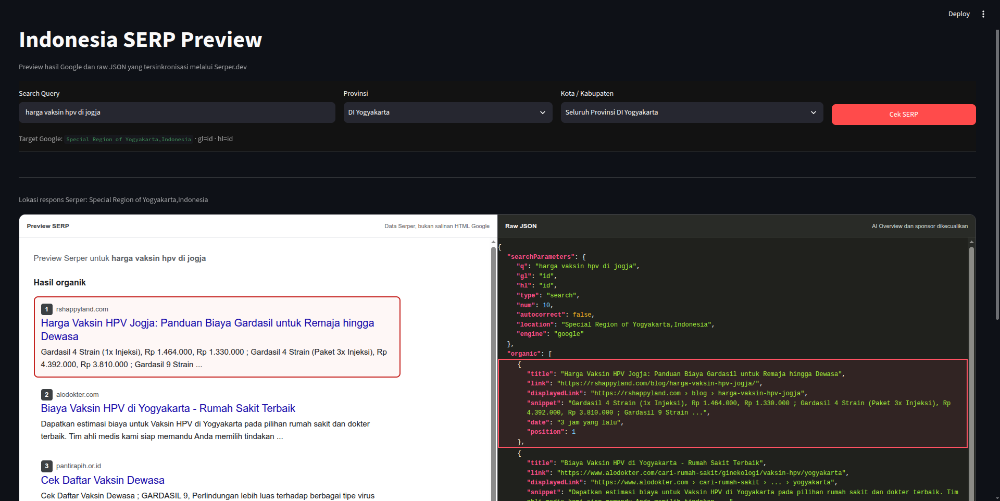

# Indonesia SERP Preview

Aplikasi Streamlit untuk memeriksa hasil pencarian Google berdasarkan lokasi di Indonesia melalui [Serper.dev](https://serper.dev/). Preview SERP dan respons JSON ditampilkan berdampingan agar setiap hasil mudah dibandingkan.





## Fitur

- Pencarian berdasarkan kata kunci dan lokasi Indonesia.
- 549 target lokasi yang tersedia di `locations.json`, mencakup target nasional, provinsi, serta kota/kabupaten.
- Preview untuk hasil organik, Local Pack, Shopping, dan pertanyaan terkait ketika datanya tersedia.
- Raw JSON Serper ditampilkan di samping preview.
- Klik hasil pada preview atau JSON untuk menyorot data pasangannya.
- Parameter pencarian Indonesia menggunakan `gl=id` dan `hl=id`.
- Satu request Serper untuk setiap pengecekan.
- Penanganan error API tanpa menampilkan API key pada antarmuka.

AI Overview, iklan, dan Shopping Ads sengaja dikecualikan dari preview dan panel JSON.

## Cara kerja

1. Pengguna memasukkan kata kunci dan memilih lokasi.
2. Aplikasi mengirim request ke endpoint Google Search milik Serper.dev.
3. Request menyertakan lokasi canonical, `gl=id`, `hl=id`, dan maksimal 10 hasil.
4. Respons JSON diubah menjadi preview SERP.
5. Preview dan raw JSON ditampilkan secara tersinkronisasi.

Preview dibangun dari data Serper.dev. Aplikasi tidak mengambil atau menyalin HTML halaman Google.

## Prasyarat

- Python 3.12
- Akun dan API key [Serper.dev](https://serper.dev/)
- Kredit Serper yang masih tersedia

## Instalasi

Clone atau unduh repository ini, lalu buka direktorinya.

### Linux dan macOS

```bash
python3 -m venv venv
source venv/bin/activate
python -m pip install --upgrade pip
pip install -r requirements.txt
```

### Windows PowerShell

```powershell
py -m venv venv
venv\Scripts\Activate.ps1
python -m pip install --upgrade pip
pip install -r requirements.txt
```

## Konfigurasi API key

Pilih salah satu cara berikut.

### Environment variable

Linux atau macOS:

```bash
export SERPER_API_KEY="your-serper-key"
```

Windows PowerShell:

```powershell
$env:SERPER_API_KEY="your-serper-key"
```

### Streamlit secrets

Salin file contoh:

```bash
cp .streamlit/secrets.toml.example .streamlit/secrets.toml
```

Kemudian isi `.streamlit/secrets.toml`:

```toml
SERPER_API_KEY = "your-serper-key"
```

`.streamlit/secrets.toml` sudah dikecualikan melalui `.gitignore`. Jangan menaruh API key di source code, README, screenshot, commit, atau issue GitHub.

## Menjalankan aplikasi

```bash
streamlit run app.py
```

Konfigurasi bawaan menjalankan aplikasi pada:

```text
http://localhost:8520
```

Masukkan kata kunci, pilih provinsi dan kota/kabupaten, lalu tekan **Cek SERP**. Setiap pengecekan menggunakan satu request dari akun Serper Anda.

## Pengujian

```bash
python -m unittest discover -s tests -v
```

Unit test menggunakan mock untuk request Serper sehingga tidak memakai kredit API.

## Memperbarui data lokasi

`locations.json` sudah tersedia dan dapat langsung digunakan. Untuk membangunnya kembali:

```bash
python build_locations.py
```

Proses ini membutuhkan koneksi internet karena mengambil data wilayah dari API Wilayah Indonesia milik Emsifa. Periksa hasilnya sebelum melakukan commit karena pembaruan sumber data dapat mengubah label atau canonical location.

## Struktur proyek

```text
.
├── .streamlit/
│   ├── config.toml
│   └── secrets.toml.example
├── docs/
│   └── images/
│       ├── search-form.png
│       └── search-results.png
├── tests/
│   └── test_errors.py
├── .gitignore
├── app.py
├── build_locations.py
├── locations.json
├── renderer.py
├── requirements.txt
└── scraper.py
```

| File | Kegunaan |
| --- | --- |
| `app.py` | Antarmuka Streamlit dan pengelolaan state pencarian |
| `scraper.py` | Client request ke endpoint Serper.dev |
| `renderer.py` | Preview SERP, raw JSON, dan sinkronisasi antar-panel |
| `locations.json` | Daftar target lokasi yang digunakan aplikasi |
| `build_locations.py` | Pembuat ulang data lokasi |
| `tests/test_errors.py` | Pengujian client API, renderer, keamanan URL, dan UI |

## Batasan

- Aplikasi belum menyimpan histori pencarian atau perubahan ranking.
- Isi SERP bergantung pada respons Serper.dev untuk kata kunci dan lokasi yang dipilih.
- Preview dapat berbeda dari halaman Google yang dilihat langsung oleh pengguna.
- Ketersediaan Organic Results, Local Pack, Shopping, dan People Also Ask tidak selalu sama pada setiap pencarian.
- Daftar lokasi mengikuti data yang sudah tersimpan di `locations.json`.

## Keamanan

- API key hanya dibaca dari environment variable atau Streamlit secrets.
- URL hasil dibatasi ke skema HTTP dan HTTPS sebelum ditampilkan sebagai tautan.
- Nilai dari respons API di-escape sebelum dimasukkan ke HTML.
- Profil browser, virtual environment, cache, secret lokal, dan hasil build dikecualikan dari Git.

Jika API key pernah masuk ke commit atau screenshot publik, segera cabut key tersebut dari dashboard Serper dan buat key baru.

## Penggunaan

Proyek ini cocok untuk eksperimen, riset SEO, dan pemeriksaan SERP secara manual. Pastikan penggunaan API mengikuti ketentuan Serper.dev serta kebijakan layanan yang terkait.
